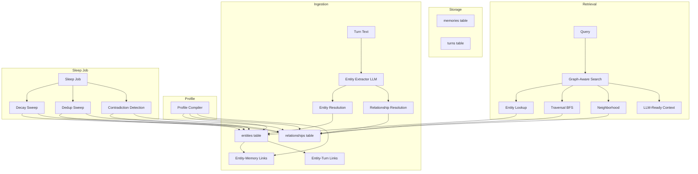
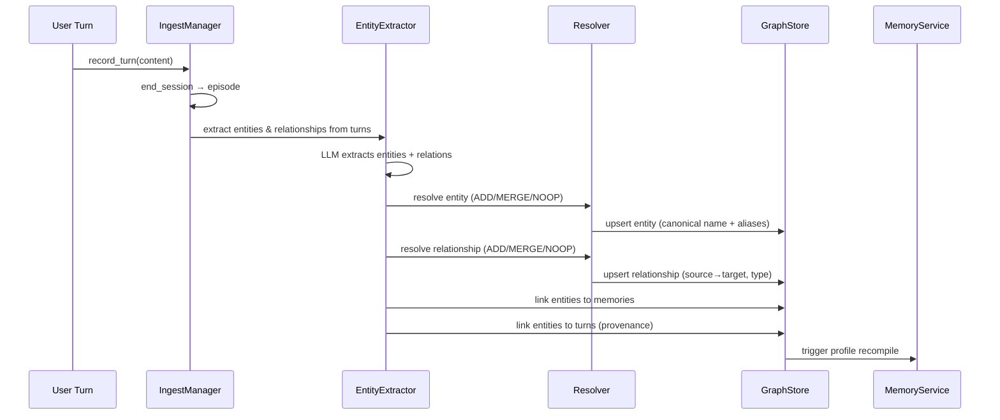
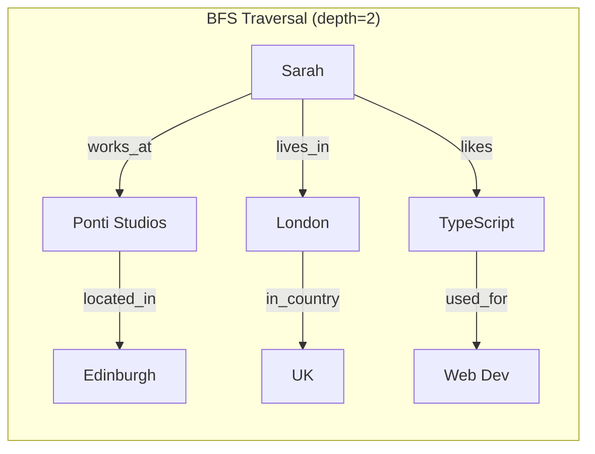
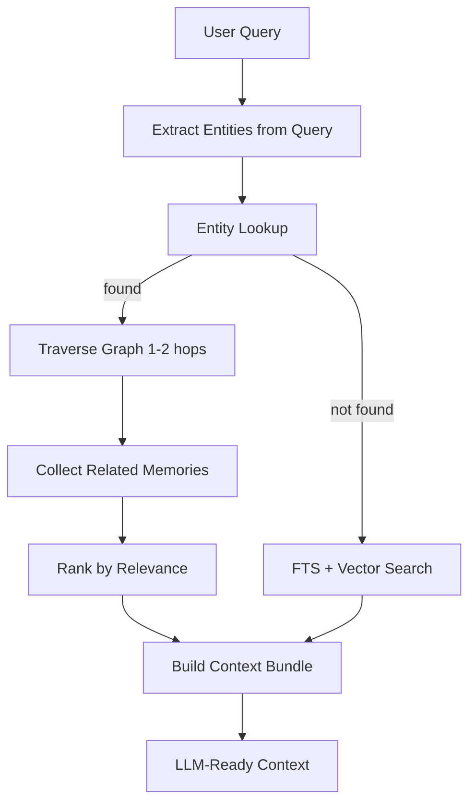
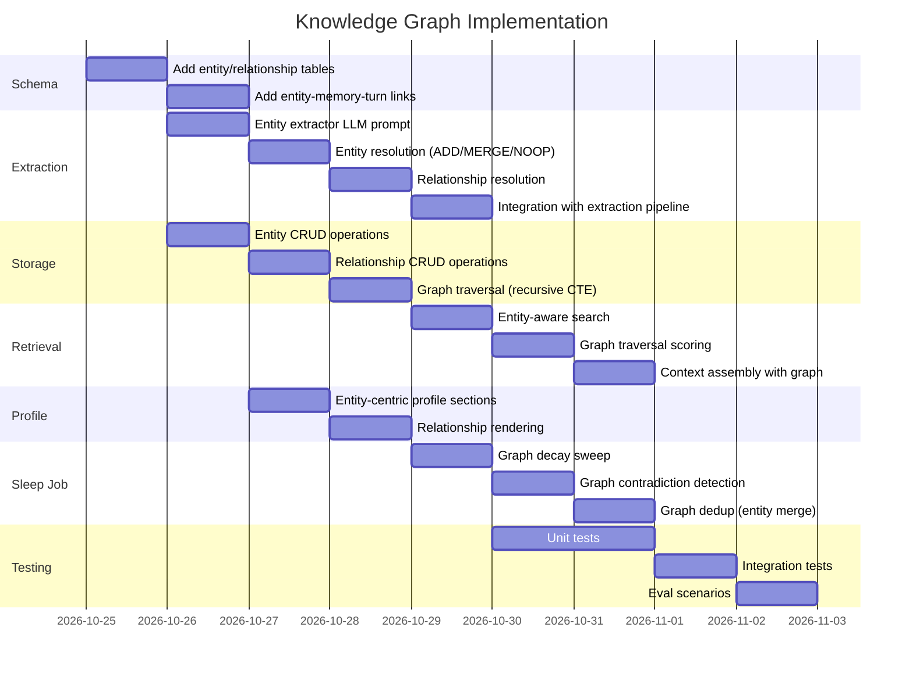

# Knowledge Graph Architecture for Seme

## Overview

A knowledge graph layer that extracts entities and relationships from conversations,
stores them in SQLite, and enables traversal, neighborhood exploration, and graph-aware
retrieval. This is the foundation for KB Intelligence (#18), Knowledge Wiki (#13),
and Hybrid Search (#16).

---

## 1. Data Model

### Entity Node

```
┌─────────────────────────────────────────────────────┐
│                    Entity                            │
├─────────────────────────────────────────────────────┤
│ id              TEXT PRIMARY KEY (uuid)              │
│ name            TEXT NOT NULL (canonical name)       │
│ type            TEXT NOT NULL (person, place, org,   │
│                 concept, topic, project, tool, etc.) │
│ aliases         TEXT (JSON array of alt names)       │
│ description     TEXT (LLM-generated summary)         │
│ first_seen_at   TEXT NOT NULL                        │
│ last_seen_at    TEXT NOT NULL                        │
│ mention_count   INTEGER NOT NULL DEFAULT 1           │
│ confidence      REAL NOT NULL (0.0-1.0)             │
│ source_type     TEXT NOT NULL (user_stated, etc.)   │
│ profile_included INTEGER NOT NULL DEFAULT 0         │
│ pinned          INTEGER NOT NULL DEFAULT 0          │
└─────────────────────────────────────────────────────┘
```

### Relationship Edge

```
┌─────────────────────────────────────────────────────┐
│                  Relationship                        │
├─────────────────────────────────────────────────────┤
│ id              TEXT PRIMARY KEY (uuid)              │
│ source_id       TEXT NOT NULL REFERENCES entities(id)│
│ target_id       TEXT NOT NULL REFERENCES entities(id)│
│ relation_type   TEXT NOT NULL (works_at, lives_in,   │
│                 likes, knows, uses, prefers, etc.)   │
│ description     TEXT (LLM-generated context)         │
│ weight          REAL NOT NULL DEFAULT 1.0 (0.0-1.0) │
│ first_seen_at   TEXT NOT NULL                        │
│ last_seen_at    TEXT NOT NULL                        │
│ mention_count   INTEGER NOT NULL DEFAULT 1           │
│ confidence      REAL NOT NULL (0.0-1.0)             │
│ source_type     TEXT NOT NULL                        │
│ source_turn_id  TEXT NOT NULL REFERENCES turns(id)  │
│ source_episode_id TEXT NOT NULL REFERENCES episodes(id)│
│ valid_from      TEXT (temporal: when relationship started)│
│ valid_to        TEXT (temporal: when relationship ended)│
└─────────────────────────────────────────────────────┘
```

### Entity-Memory Link (many-to-many)

```
┌─────────────────────────────────────────────────────┐
│              EntityMemoryLink                        │
├─────────────────────────────────────────────────────┤
│ entity_id       TEXT NOT NULL REFERENCES entities(id)│
│ memory_id       TEXT NOT NULL REFERENCES memories(id)│
│ role            TEXT NOT NULL (subject, object,      │
│                 context, mentioned)                  │
│ created_at      TEXT NOT NULL                        │
│ PRIMARY KEY (entity_id, memory_id)                  │
└─────────────────────────────────────────────────────┘
```

### Entity-Turn Link (provenance)

```
┌─────────────────────────────────────────────────────┐
│              EntityTurnLink                          │
├─────────────────────────────────────────────────────┤
│ entity_id       TEXT NOT NULL REFERENCES entities(id)│
│ turn_id         TEXT NOT NULL REFERENCES turns(id)   │
│ mention_text    TEXT NOT NULL (verbatim mention)     │
│ role            TEXT NOT NULL (subject, object)      │
│ created_at      TEXT NOT NULL                        │
│ PRIMARY KEY (entity_id, turn_id)                    │
└─────────────────────────────────────────────────────┘
```

---

## 2. Architecture Diagram



---

## 3. Entity Extraction Pipeline



### Entity Extraction Prompt

The LLM extracts entities and relationships from a conversation episode:

```
RULES:
1. Extract named entities: people, places, organizations, projects, tools, concepts, topics.
2. Extract relationships between entities: works_at, lives_in, likes, uses, prefers, knows, created, etc.
3. Canonicalize names: "JS" → "JavaScript", "my wife Sarah" → "Sarah".
4. Track aliases: "John" and "Johnny" are the same entity.
5. Only extract entities the user mentioned or adopted.
6. Third-party content → modality=quoted, lower confidence.
7. Output strict JSON with entities and relationships arrays.
```

---

## 4. Storage Layer

### New SQLite Tables

```sql
-- entities
CREATE TABLE entities (
    id              TEXT PRIMARY KEY,
    name            TEXT NOT NULL,
    type            TEXT NOT NULL CHECK (type IN (
                        'person', 'place', 'organization', 'project',
                        'tool', 'concept', 'topic', 'preference', 'other')),
    aliases         TEXT,  -- JSON array
    description     TEXT,
    first_seen_at   TEXT NOT NULL,
    last_seen_at    TEXT NOT NULL,
    mention_count   INTEGER NOT NULL DEFAULT 1,
    confidence      REAL NOT NULL CHECK (confidence >= 0.0 AND confidence <= 1.0),
    source_type     TEXT NOT NULL,
    profile_included INTEGER NOT NULL DEFAULT 0,
    pinned          INTEGER NOT NULL DEFAULT 0
);
CREATE INDEX idx_entities_name ON entities(name);
CREATE INDEX idx_entities_type ON entities(type);

-- relationships
CREATE TABLE relationships (
    id              TEXT PRIMARY KEY,
    source_id       TEXT NOT NULL REFERENCES entities(id),
    target_id       TEXT NOT NULL REFERENCES entities(id),
    relation_type   TEXT NOT NULL,
    description     TEXT,
    weight          REAL NOT NULL DEFAULT 1.0,
    first_seen_at   TEXT NOT NULL,
    last_seen_at    TEXT NOT NULL,
    mention_count   INTEGER NOT NULL DEFAULT 1,
    confidence      REAL NOT NULL,
    source_type     TEXT NOT NULL,
    source_turn_id  TEXT NOT NULL REFERENCES turns(id),
    source_episode_id TEXT NOT NULL REFERENCES episodes(id),
    valid_from      TEXT,
    valid_to        TEXT
);
CREATE INDEX idx_rel_source ON relationships(source_id);
CREATE INDEX idx_rel_target ON relationships(target_id);
CREATE INDEX idx_rel_type ON relationships(relation_type);

-- entity_memory_links
CREATE TABLE entity_memory_links (
    entity_id   TEXT NOT NULL REFERENCES entities(id),
    memory_id   TEXT NOT NULL REFERENCES memories(id),
    role        TEXT NOT NULL CHECK (role IN ('subject', 'object', 'context', 'mentioned')),
    created_at  TEXT NOT NULL,
    PRIMARY KEY (entity_id, memory_id)
);

-- entity_turn_links
CREATE TABLE entity_turn_links (
    entity_id   TEXT NOT NULL REFERENCES entities(id),
    turn_id     TEXT NOT NULL REFERENCES turns(id),
    mention_text TEXT NOT NULL,
    role        TEXT NOT NULL CHECK (role IN ('subject', 'object')),
    created_at  TEXT NOT NULL,
    PRIMARY KEY (entity_id, turn_id)
);
```

### SQLite Traversal

For graph traversal, we use recursive CTEs (Common Table Expressions):

```sql
-- Find all entities within N hops of a starting entity
WITH RECURSIVE traversal(entity_id, depth, path) AS (
    SELECT id, 0, id FROM entities WHERE id = ?
    UNION ALL
    SELECT r.target_id, t.depth + 1, t.path || ',' || r.target_id
    FROM traversal t
    JOIN relationships r ON r.source_id = t.entity_id
    WHERE t.depth < ? AND t.path NOT LIKE '%' || r.target_id || '%'
)
SELECT DISTINCT e.*, t.depth
FROM traversal t
JOIN entities e ON e.id = t.entity_id
ORDER BY t.depth;
```

### Traversal Diagram



---

## 5. Graph-Aware Retrieval



### Retrieval Strategy

1. **Entity extraction from query**: Use simple NER or LLM to find entities in the user's query.
2. **Entity lookup**: Find matching entities in the graph (by name or alias).
3. **Traversal**: BFS from matched entities, collecting related entities within N hops.
4. **Memory collection**: For each entity in the traversal result, collect linked memories.
5. **Ranking**: Combine direct matches (high score) with graph-derived matches (lower score, decayed by hop distance).
6. **Context assembly**: Build the final context bundle with memories, profile, and graph summary.

### Scoring

```
score = direct_match_score * 1.0
      + graph_1hop_score * 0.7
      + graph_2hop_score * 0.4
      + entity_mention_boost * 0.2
```

---

## 6. Profile Integration

The profile compiler should include entity-centric sections:

```markdown
## Profile
- User: Charles Ponti
- Location: London (moved from Edinburgh)

## Entities
- Sarah (wife, doctor) — mentioned 5 times
- Ponti Studios (employer) — mentioned 3 times
- TypeScript (preferred language) — mentioned 8 times

## Relationships
- Charles works_at Ponti Studios
- Charles lives_in London
- Charles prefers TypeScript
```

### Profile Compiler Changes

1. Query entities with `profile_included = 1`.
2. Query relationships between profile-included entities.
3. Render entity section with mention counts.
4. Render relationship section as subject-predicate-object triples.
5. Include in the existing profile text.

---

## 7. Sleep Job Integration

### Decay Sweep (Graph-Aware)

- Entity mention_count decays if not re-mentioned.
- Relationships decay if not re-mentioned.
- Low-confidence entities (mention_count < 2, confidence < 0.3) are archived.
- Entity aliases are merged during dedup sweep.

### Contradiction Detection

- Same entity with conflicting relationships (e.g., "lives_in London" and "lives_in Tokyo") → flag for review.
- Same entity with conflicting types (e.g., "Sarah" as both "person" and "organization") → flag for review.

### Dedup Sweep

- Merge entities with same canonical name + type.
- Merge aliases into the canonical entity.
- Merge relationships with same source+target+type.

---

## 8. API Endpoints

### Entity Endpoints

| Method | Path | Description |
|--------|------|-------------|
| GET | `/entities` | List all entities (with type filter, search) |
| GET | `/entities/:id` | Get entity with relationships |
| GET | `/entities/:name` | Get entity by name (with aliases) |
| POST | `/entities` | Create entity manually |
| PUT | `/entities/:id` | Update entity |
| DELETE | `/entities/:id` | Delete entity (cascade to relationships) |

### Relationship Endpoints

| Method | Path | Description |
|--------|------|-------------|
| GET | `/relationships` | List relationships (with source/target/type filters) |
| GET | `/relationships/:id` | Get relationship |
| POST | `/relationships` | Create relationship manually |
| DELETE | `/relationships/:id` | Delete relationship |

### Graph Traversal Endpoints

| Method | Path | Description |
|--------|------|-------------|
| GET | `/graph/neighborhood/:entityId` | Get N-hop neighborhood |
| GET | `/graph/path/:from/:to` | Find shortest path between entities |
| GET | `/graph/snapshot` | Full graph snapshot (for visualization) |
| GET | `/graph/entities` | List entities (paginated, with type filter) |
| GET | `/graph/entity/:name` | Get entity with all relationships |

### Graph-Aware Search

| Method | Path | Description |
|--------|------|-------------|
| POST | `/search` | Hybrid search (memories + graph + FTS) |

---

## 9. Implementation Order



---

## 10. Migration Strategy

### Schema Migration v3

```sql
-- entities table
CREATE TABLE entities (...);

-- relationships table
CREATE TABLE relationships (...);

-- entity_memory_links table
CREATE TABLE entity_memory_links (...);

-- entity_turn_links table
CREATE TABLE entity_turn_links (...);

-- indexes
CREATE INDEX idx_entities_name ON entities(name);
CREATE INDEX idx_entities_type ON entities(type);
CREATE INDEX idx_rel_source ON relationships(source_id);
CREATE INDEX idx_rel_target ON relationships(target_id);
CREATE INDEX idx_rel_type ON relationships(relation_type);
CREATE INDEX idx_entity_memory_links_entity ON entity_memory_links(entity_id);
CREATE INDEX idx_entity_memory_links_memory ON entity_memory_links(memory_id);
CREATE INDEX idx_entity_turn_links_entity ON entity_turn_links(entity_id);
CREATE INDEX idx_entity_turn_links_turn ON entity_turn_links(turn_id);
```

### Migration Approach

Since this is a new feature (not modifying existing tables), we can use `CREATE TABLE IF NOT EXISTS` in a new migration (v3). No data migration needed — existing memories remain as-is, and new entities/relationships are extracted going forward.

---

## 11. Entity Types

| Type | Description | Examples |
|------|-------------|----------|
| person | A person mentioned | Sarah, John, Charles |
| place | A location | London, Edinburgh, Tokyo |
| organization | A company or institution | Ponti Studios, Google |
| project | A project or product | Seme, VoiceNote |
| tool | A tool or technology | TypeScript, React, Postgres |
| concept | An abstract concept | memory, extraction, decay |
| topic | A subject area | AI, music, cooking |
| preference | A stated preference | dark mode, coffee |
| other | Anything else | — |

## 12. Relationship Types

| Type | Description | Example |
|------|-------------|---------|
| works_at | Employment | Charles → Ponti Studios |
| lives_in | Residence | Charles → London |
| located_in | Location of org | Ponti Studios → Edinburgh |
| likes | Preference | Charles → TypeScript |
| uses | Tool usage | Charles → TypeScript |
| knows | Acquaintance | Charles → John |
| created | Creation | Charles → Seme |
| prefers | Preference | Charles → dark mode |
| moved_to | Relocation | Charles → Edinburgh (from London) |
| married_to | Relationship | Charles → Sarah |
| is_a | Classification | Sarah → doctor |
| related_to | Generic relation | — |

---

## 13. Key Design Decisions

1. **Entity canonicalization**: The LLM canonicalizes entity names during extraction. "JS" → "JavaScript", "my wife Sarah" → "Sarah". Aliases are tracked separately.

2. **Relationship weight**: Relationships have a weight (0.0-1.0) that increases with mention count. This allows ranking by importance.

3. **Temporal relationships**: Relationships have `valid_from` and `valid_to` for temporal queries (e.g., "Charles lived in London until 2023").

4. **Graph traversal depth**: Default 2 hops. Deeper traversal is expensive and rarely needed.

5. **Entity-memory links**: Many-to-many. An entity can be mentioned in multiple memories, and a memory can mention multiple entities.

6. **Profile integration**: Entity-centric sections are added to the profile. This makes the profile more structured and informative.

7. **Sleep job integration**: The sleep job decays entities and relationships, detects contradictions, and merges duplicates. This keeps the graph clean.

8. **No graph database**: We use SQLite with recursive CTEs. This is sufficient for single-user, local-first use. No need for Neo4j.

9. **Extraction is additive**: Entities and relationships are extracted alongside memories. The extraction pipeline calls the entity extractor after extracting memories.

10. **Confidence scoring**: Entities and relationships have confidence scores based on source type, same as memories. User-stated entities have high confidence, agent-inferred have lower.

---

## 14. Open Questions

1. **Entity extraction model**: Should we use the same LLM as memory extraction, or a separate specialized model? Same model is simpler.

2. **Relationship directionality**: Should relationships be directed (A→B) or undirected? Directed is more precise but requires more careful extraction.

3. **Entity merging**: When two entities have the same name but different types (e.g., "Apple" as fruit vs company), should they be separate entities? Yes, separate by type.

4. **Graph size limits**: Should we limit the number of entities/relationships? For single-user, probably not needed. But we should monitor.

5. **Visualization**: Should we build a 3D graph UI like Ricord? That's a frontend concern, not a backend one. The backend just provides the snapshot endpoint.

---

## 15. Next Steps

1. Create the schema migration (v3).
2. Implement the entity extractor (LLM prompt + parser).
3. Implement entity resolution (ADD/MERGE/NOOP).
4. Implement relationship resolution.
5. Implement graph traversal (recursive CTEs).
6. Implement entity-aware retrieval.
7. Implement profile integration.
8. Implement sleep job integration.
9. Add tests and evals.
10. Update the landing page.

Ready to start building? The first step is the schema migration.